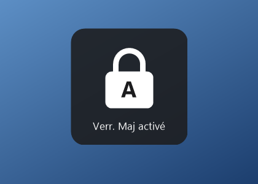
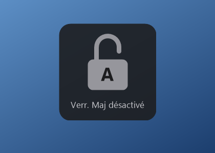
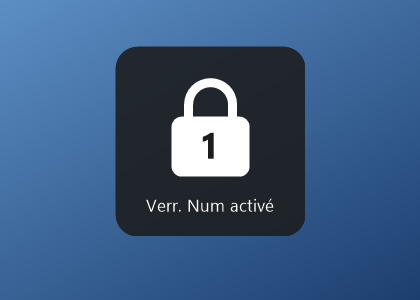
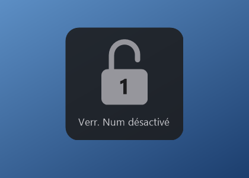

<div align="center">




# Adion CapNotification

**L'indicateur Verr. Maj / Verr. Num que votre PC n'affiche plus.**

[](https://github.com/myadion/capnotification/releases/latest)
[](LICENSE)


[English](README.md)

</div>

La plupart des portables affichent un petit indicateur quand on appuie sur Verr. Maj ou Verr. Num. Cet indicateur vient de l'utilitaire clavier du fabricant, et sur un vieux PC passé à Windows 11 cet utilitaire ne fonctionne souvent plus. On tape alors à l'aveugle, ou avec un bip.

Adion CapNotification remet l'indicateur. Un fichier de 30 Ko, rien à régler.

## Ce qu'il fait

- **Verr. Maj, Verr. Num et Arrêt défil** : un cadenas apparaît en bas de l'écran, fermé et blanc quand la touche est active, ouvert et gris quand elle ne l'est pas.
- **Il ne gêne pas** : il ne prend jamais le focus, les clics passent au travers, et il s'efface au bout d'une seconde et demie.
- **Rien à régler** : pas de fenêtre de réglages, pas d'icône près de l'horloge, pas de compte.
- **Dans votre langue** : il suit la langue d'affichage de Windows (français, anglais, espagnol, allemand, italien, portugais, néerlandais).
- **Il remplace le bip** : il coupe le son « Touches bascules » de Windows, que l'indicateur rend inutile.
- **Discret** : aucun accès au réseau, aucune télémétrie, aucun crochet clavier.
- **Minuscule** : un seul exécutable de 30 Ko, aucune dépendance à installer.

| Verr. Maj | Verr. Num |
| :---: | :---: |
|  |  |
|  |  |

## Installer

1. Téléchargez `AdionCapNotification-Setup.exe` depuis la [dernière version](https://github.com/myadion/capnotification/releases/latest).
2. Double-cliquez dessus et acceptez la demande de droits d'administrateur.
3. C'est tout. Le programme tourne, et il démarrera à chaque ouverture de session.

> **Windows SmartScreen.** L'exécutable n'est pas signé : Windows peut afficher « Windows a protégé votre ordinateur » au premier lancement. Cliquez sur **Informations complémentaires**, puis sur **Exécuter quand même**. Vous pouvez comparer le fichier à l'empreinte SHA-256 publiée avec chaque version.

### Configuration requise

- Windows 8, 10 ou 11 : rien à installer.
- Windows 7 : il faut .NET Framework 4.

Développé et essayé sous Windows 11. Les versions antérieures devraient fonctionner mais n'ont pas été essayées.

## Désinstaller

Ouvrez **Paramètres › Applications › Applications installées** (ou **Programmes et fonctionnalités** sur les anciennes versions), cherchez **Adion CapNotification** et choisissez **Désinstaller**.

La désinstallation ne réactive pas le bip des touches bascules. Pour le retrouver : **Paramètres › Accessibilité › Clavier**.

## Ligne de commande

Pour les techniciens qui le posent sur plusieurs machines :

| Commande | Effet |
| --- | --- |
| `AdionCapNotification-Setup.exe` | Installe, puis affiche une confirmation. |
| `AdionCapNotification-Setup.exe /silent` | Installe sans aucun message. La demande de droits apparaît quand même, sauf si la commande tourne déjà en administrateur. |
| `AdionCapNotification.exe /uninstall` | Désinstalle. Ajoutez `/silent` pour le faire sans message. |
| `AdionCapNotification-Setup.exe /run` | Lance le programme sans l'installer, pour l'essayer. |

## Comment ça marche

Tout le programme tient dans [un seul fichier C#](src/Program.cs).

- **La détection.** Il lit l'état des trois touches avec `GetKeyState` environ seize fois par seconde et réagit quand l'une change. Il n'y a pas de crochet clavier : il ne voit jamais ce que vous tapez, et un antivirus n'a aucune raison de le prendre pour un enregistreur de frappe. Il voit aussi les changements qui ne viennent pas de la touche elle-même, comme Maj qui relâche Verr. Maj sur un clavier français.
- **L'affichage.** Une fenêtre transparente au pixel près, qui laisse passer les clics et ne s'active jamais. Elle apparaît sur l'écran de la fenêtre active.
- **L'installation.** Le fichier d'installation est le programme lui-même. Lancé depuis n'importe où, il se copie dans `Program Files\Adion\CapNotification`, s'inscrit sous `HKLM\...\Run` pour démarrer à l'ouverture de session de chaque compte, et ajoute une entrée à la liste des applications installées. Le programme tourne ensuite avec les droits d'un utilisateur ordinaire.
- **Le bip.** Au démarrage, il coupe l'option Touches bascules et son raccourci (Verr. Num maintenue cinq secondes) pour le compte en cours. Si votre bip vient du BIOS ou d'un autre utilitaire, il restera.

## Compiler

Il ne faut rien d'autre que Windows : le script utilise le compilateur C# livré avec .NET Framework.

```powershell
powershell -ExecutionPolicy Bypass -File build.ps1
```

Le résultat est `dist\AdionCapNotification-Setup.exe`.

## Contribuer

Les tickets et les propositions de modification sont les bienvenus.

**Ajouter une langue** tient en un bloc : ajoutez un `case` avec le code à deux lettres de votre langue dans `Texts.Pick()` de [src/Program.cs](src/Program.cs) et traduisez les dix textes. Gardez des libellés courts, tels que votre clavier ou Windows nomment les touches.

Merci de garder l'esprit du projet : un fichier, aucune dépendance, aucun réglage.

## Licence

[MIT](LICENSE) © Adion Technologies
