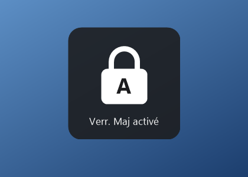
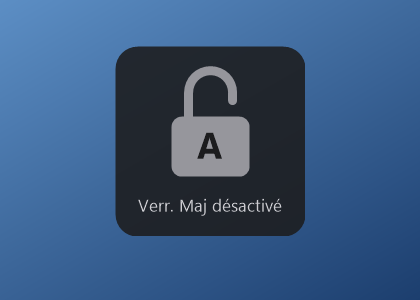
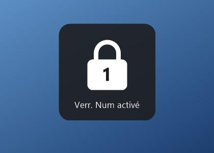
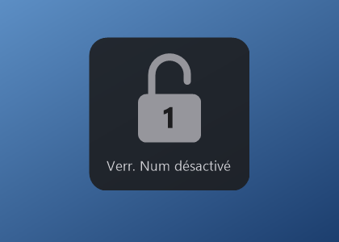

<div align="center">




# Adion CapNotification

**The Caps Lock / Num Lock on-screen indicator your PC forgot to ship.**

[](https://github.com/myadion/capnotification/releases/latest)
[](LICENSE)


[Français](README.fr.md)

</div>

Most laptops show a small indicator when you press Caps Lock or Num Lock. That indicator comes from the manufacturer's keyboard utility, and on older machines upgraded to Windows 11 that utility often no longer works. You are left guessing, or with a beep.

Adion CapNotification brings the indicator back. One 30 KB file, nothing to configure.

## Features

- **Caps Lock, Num Lock and Scroll Lock**: a padlock appears at the bottom of the screen, closed and white when the key is on, open and grey when it is off.
- **Stays out of the way**: it never takes focus, clicks pass through it, and it fades out after a second and a half.
- **Nothing to configure**: no settings window, no tray icon, no account.
- **Speaks your language**: follows the Windows display language (English, French, Spanish, German, Italian, Portuguese, Dutch).
- **Replaces the beep**: turns off the Windows "Toggle Keys" sound, since the indicator does its job.
- **Private**: no network access, no telemetry, no keyboard hook.
- **Tiny**: a single 30 KB executable, no dependencies to install.

| Caps Lock | Num Lock |
| :---: | :---: |
|  |  |
|  |  |

The screenshots show the French labels.

## Install

1. Download `AdionCapNotification-Setup.exe` from the [latest release](https://github.com/myadion/capnotification/releases/latest).
2. Double-click it and accept the administrator prompt.
3. Done. It is running, and it will start with every Windows session.

> **Windows SmartScreen.** The executable is not code-signed, so Windows may show "Windows protected your PC" the first time. Click **More info**, then **Run anyway**. You can check the file against the SHA-256 published with each release.

### Requirements

- Windows 8, 10 or 11: nothing to install.
- Windows 7: needs .NET Framework 4.

Developed and tested on Windows 11. Earlier versions are expected to work but have not been tested.

## Uninstall

Open **Settings › Apps › Installed apps** (or **Programs and Features** on older versions), find **Adion CapNotification** and choose **Uninstall**.

Uninstalling does not turn the Toggle Keys beep back on. If you want it, enable it in **Settings › Accessibility › Keyboard**.

## Command line

For technicians who deploy it on several machines:

| Command | Effect |
| --- | --- |
| `AdionCapNotification-Setup.exe` | Installs, then shows a confirmation. |
| `AdionCapNotification-Setup.exe /silent` | Installs without any message. The administrator prompt still appears unless the command already runs elevated. |
| `AdionCapNotification.exe /uninstall` | Uninstalls. Add `/silent` to skip the messages. |
| `AdionCapNotification-Setup.exe /run` | Runs without installing, to try it out. |

## How it works

The whole program is [one C# file](src/Program.cs).

- **Detection.** It reads the state of the three keys with `GetKeyState` about sixteen times a second and reacts when one changes. There is no keyboard hook, so it never sees what you type, and antivirus software has no reason to mistake it for a keylogger. It also catches changes that do not come from the key itself, such as Shift releasing Caps Lock on a French keyboard.
- **Display.** A layered, click-through, non-activating window drawn with per-pixel transparency. It appears on the monitor of the active window.
- **Installation.** The setup file is the program itself. Run from anywhere, it copies itself to `Program Files\Adion\CapNotification`, registers itself under `HKLM\...\Run` so it starts at sign-in for every account, and adds an entry to the installed apps list. The program then runs with normal user rights.
- **The beep.** At startup it clears the Toggle Keys flag and its shortcut (holding Num Lock for five seconds) for the current account. If your beep comes from the BIOS or from another utility, it will stay.

## Build from source

You need nothing but Windows: the script uses the C# compiler that ships with .NET Framework.

```powershell
powershell -ExecutionPolicy Bypass -File build.ps1
```

The result is `dist\AdionCapNotification-Setup.exe`.

## Contributing

Issues and pull requests are welcome.

**Adding a language** takes one block: add a `case` with your two-letter language code to `Texts.Pick()` in [src/Program.cs](src/Program.cs) and translate the ten strings. Keep the key labels short, the way your keyboard or Windows names them.

Please keep the spirit of the project: one file, no dependencies, no settings.

## License

[MIT](LICENSE) © Adion Technologies
